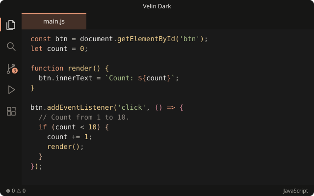
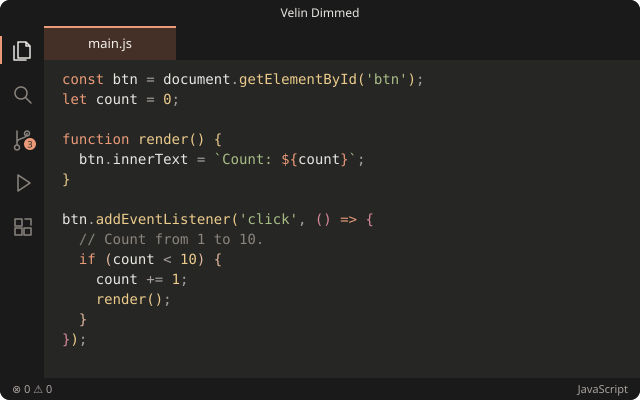

<p align="center"></p>

# Velin

Warm, low-glare dark themes for VS Code: charcoal backgrounds, cream text and a soft clay-orange accent. Everything is drawn from one fixed **18-color palette**, in the spirit of Nord.

| Velin Dark | Velin Dimmed |
| --- | --- |
|  |  |

## What you get

- **Two color themes**, both using the same palette and syntax colors:
  - **Velin Dark**: deep charcoal, editor `#1a1a1a`.
  - **Velin Dimmed**: one step lighter, warm gray editor `#262624`.
- **Full UI coverage**: editor, side bar, tabs, panels, peek view, diff and merge editors, debug, testing, notebooks, SCM graph and more. No surface falls back to VS Code's default blue or gray.
- **Terminal colors included**: the 16 ANSI colors are part of the theme, so the integrated terminal picks them up as soon as you select Velin. Nothing extra to install.
- **Syntax highlighting** tuned for Python, SQL and JavaScript/TypeScript, including semantic tokens (Pylance). Comments are not italic, because an italic `|` looks like `/` in many monospace fonts.
- **Optional style for [Markdown Preview Enhanced](https://marketplace.visualstudio.com/items?itemName=shd101wyy.markdown-preview-enhanced)**: a matching preview with a centered reading column and a **Copy** button on code blocks. See [Markdown Preview Enhanced](#markdown-preview-enhanced) below.

## Installation

1. Download the `.vsix` from the [Releases](https://github.com/whtbl3/velin/releases) page, or build it yourself (see [Build](#build)).
2. In VS Code, run **Extensions: Install from VSIX...** and pick the file.
3. Open the theme picker (`Ctrl+K Ctrl+T`) and choose **Velin Dark** or **Velin Dimmed**.

On WSL, SSH or Dev Containers, install it while connected to the remote, so the Markdown Preview Enhanced files land where that extension reads them.

## Markdown Preview Enhanced

Velin does **not** install Markdown Preview Enhanced (MPE) for you. MPE is a separate extension; install it from the Marketplace if you want the matching preview.

When MPE is installed, Velin asks once per version whether to apply its preview style. You can also run **Velin: Install Markdown Preview Enhanced Style** at any time. The command:

- writes `style.less`, `head.html` and `copy-button.js` into MPE's global config folder (an existing file that Velin did not write is kept as `<name>.bak-<timestamp>`);
- sets `markdown-preview-enhanced.previewTheme` and `codeBlockTheme` to `vscode.css`;
- turns on `markdown-preview-enhanced.enablePreviewScripts`, which the Copy button needs. MPE then runs `.js` files referenced by `<script src>` from its config folder and from the open project, and only in trusted workspaces;
- opens `.md` files with MPE by default.

After that, Velin keeps the files it installed up to date on every startup.

## Palette

Both themes use the 18 colors in [`palette.json`](palette.json). Every color in the themes, including translucent ones, comes from this list, and `node scripts/check-palette.js` fails if one does not.

**Charcoal**: backgrounds and borders

| Name | Color | Velin Dark | Velin Dimmed |
| --- | --- | --- | --- |
| c0 | `#161615` | side bar, panels, terminal, peek view | shadows |
| c1 | `#1a1a1a` | editor | side bar, panels, terminal, peek view |
| c2 | `#262624` | widgets, menus, inputs | editor |
| c3 | `#30302e` | borders, indent guides | widgets, menus, inputs |
| c4 | `#4a4743` | line numbers, active guide | borders, line numbers |

**Cream**: text

| Name | Color | Used for |
| --- | --- | --- |
| bright | `#f4f1ec` | headings, bold text, active tab |
| text | `#e8e6e3` | body text, variables, parameters |
| muted | `#a8a29e` | secondary text, operators, punctuation |
| dim | `#8a847d` | comments, inactive text, inlay hints |

**Clay**: accent

| Name | Color | Used for |
| --- | --- | --- |
| accent | `#ea9a78` | keywords, decorators, `self`, links, buttons, cursor, focus border, selections (translucent) |
| surface | `#443027` | active tab background |

**Earth**: syntax and status

| Name | Color | Used for |
| --- | --- | --- |
| yellow | `#ebcb8b` | function names, numbers, `True`/`None`, warnings, bracket level 1 |
| green | `#a7bd86` | strings, added lines, passing tests |
| teal | `#94c7bb` | classes |
| blue | `#6c9fc4` | info, terminal blue |
| rose | `#d98a9a` | `UPPER_CASE` constants, bracket level 2, terminal magenta |
| pink | `#e3b9a0` | built-in types (`int`, `str`, `dict`), bracket level 3 |
| red | `#bf616a` | errors, deleted lines, failing tests |

## Notes

- **Active tab with VS Code's modern tabs.** In the default *connected* style of the modern UI, VS Code ignores the theme's tab colors and paints the active tab like the editor. To get Velin's tab color there, add this to your user `settings.json`:

  ```jsonc
  "workbench.colorCustomizations": {
    "[Velin Dark][Velin Dimmed]": {
      "modernEditorTab.activeBackground": "#443027",
      "modernEditorTab.activeHoverBackground": "#443027",
      "tab.activeBorderTop": "#ea9a78"
    }
  }
  ```

  Classic tabs and the `"pill"` style (`workbench.experimental.modernUIEditorTabStyle`) use the theme colors directly.
- **MPE config folder.** Velin finds it the same way MPE does: the `markdown-preview-enhanced.configPath` setting, then `~/.crossnote` on Windows, then `$XDG_CONFIG_HOME/crossnote`, then `~/.local/state/crossnote`.
- **Preview fonts.** The preview loads Source Sans 3, Source Serif 4 and JetBrains Mono from Google Fonts and falls back to system fonts with full Vietnamese coverage when offline.

## Build

Requires Node 22 or later. No `npm install` needed.

```bash
node scripts/build-vsix.js       # writes dist/velin-<version>.vsix
node scripts/render-preview.js   # redraws images/velin-*.svg from the theme files
node scripts/check-palette.js    # checks that every color is in palette.json
```

`build-vsix.js` packages the extension without `@vscode/vsce`. Use `vsce package` / `vsce publish` if you want to publish to the Marketplace.

## Credits

The preview styling started from [Claude Style Markdown Preview](https://github.com/ibank/claude-style-markdown-preview) (MIT).
